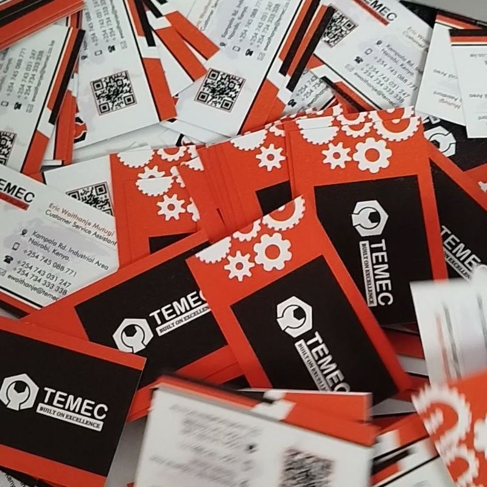

# Bluebutton Design Solutions website

Website for Bluebutton Design Solutions, a graphic design and printing studio in Nairobi. Plain HTML, CSS and JavaScript with no build step, so it can be hosted free on GitHub Pages.

## Pages

- `index.html`: Home
- `services.html`: Old address, now forwards to the catalogue
- `catalogue.html`: Full catalogue (branding, production, events, agency support)
- `portfolio.html`: Portfolio and social links
- `contact.html`: Quote form, hours and map

Shared styles are in `styles.css`, behaviour (mobile menu, open/closed badge, WhatsApp order buttons, quote form, portfolio filters) in `script.js`, and the logo, icons and service illustrations in `assets/`.

## Common edits

**Add prices.** In `catalogue.html`, change `Ask for price` next to a service to something like `From KES 1,500`.

**Add portfolio photos.** Portfolio photos are square and live in `assets/work/`. To add another, copy one `<figure class="tile" ...>` line in `portfolio.html` and change its photo and caption, for example:

```html

```

Keep photos under about 300 KB each so pages load fast on mobile data.

**Change a home page photo.** The "What we do" cards on the home page use photos from `assets/home/`. To change one, save the new photo over the old file with the same name (for example `assets/home/business-cards.jpg`). Portrait photos (4:5) suit the small cards and landscape photos (5:4) suit the four large ones. A file ending in `-2.jpg` is the second photo that fades in when you hover over the card.

**Change the WhatsApp number.** Update `WHATSAPP` at the top of `script.js` and the `wa.me` links in the HTML.

**Change opening hours.** Update the text in each page's top bar and footer, the table in `contact.html`, and `HOURS` in `script.js` (used for the "Open now" badge).

## Preview locally

Run `python3 -m http.server` in this folder and open http://localhost:8000.

## Publish with GitHub Pages

On GitHub, open Settings → Pages, set Source to "Deploy from a branch", pick the branch and `/ (root)`, then Save. The site goes live at https://mistarhummie.github.io/BLUEBUTTON/. A custom domain such as bluebutton.co.ke can be added later on the same settings page.
